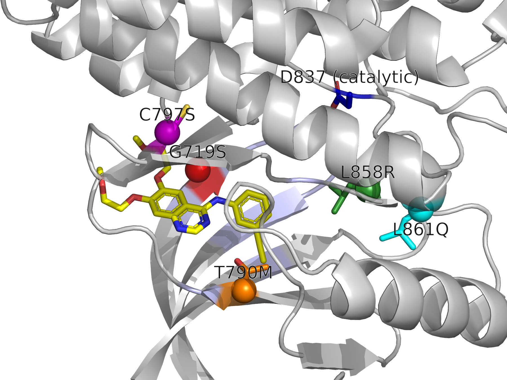

# Task 1 — Missense mutations in the EGFR kinase domain (4HJO practice case)

Run order (from repo root):
```bash
python protein/01_map.py --cif datasets/4hjo.cif.gz --uniprot P00533 --mutations G719S,T790M,C797S,L858R,L861Q
python protein/02_measure.py --pdb datasets/4hjo.pdb
pymol -cq protein/03_render.py -- datasets/4hjo.pdb
```
Python 3.9.15, Biopython 1.85, PyMOL 3.1.0 (Homebrew). No randomness anywhere, so no seed.
Retrieved inputs are cached in `protein/data/` with URLs, versions and SHA256 in `provenance.json`.

## Protein

**Retrieved (UniProt P00533):** epidermal growth factor receptor, a receptor tyrosine kinase, 1210 aa.
- Protein kinase domain: residues 712–979.
- Catalytic base: D837.
- ATP-binding residues: 718–726 (glycine-rich loop), K745, T790–Q791, D855.

**Structure (retrieved; PDB 4HJO, Park et al. 2012 *Biochem J*, PMID 23101586):**
- X-ray, 2.75 Å; chain A; kinase domain (UniProt 696–1022) bound to **erlotinib (AQ4)**.
- The kinase is in the **inactive** conformation.
- The construct carries an engineered **V948R**, an asymmetric-dimer interface mutation that keeps the kinase monomeric/inactive.

**Mapping (P1, computed, `tables/mapping.csv`):**
- Author numbering = UniProt − 24 (mature-protein numbering), so L858 is residue 834 in the file.
- SIFTS and an independent BLOSUM62 alignment agree at every candidate and functional site.
- The structure has the wild-type residue at every candidate, and all five are fully resolved.
- Unresolved segments: UniProt 734–737 and 985–996.

## Measurements (P2, computed, `tables/measurements.csv`, `tables/contacts_5A.csv`)

Distances are minimum heavy-atom distances (Å). Contacts use a 5 Å heavy-atom cutoff. RSA = Shrake–Rupley SASA (protein only) / Tien 2013 max ASA; buried if RSA < 0.25.

| Mutation | Author # | → erlotinib | → D837 (catalytic) | Nearest other functional residue (excl. i±1) | RSA | Ligand-covered SASA (Ų) | Rel. B | ΔCharge | ΔHydropathy (KD) | ΔVolume (ų) | BLOSUM62 |
|---|---|---|---|---|---|---|---|---|---|---|---|
| G719S | 695 | 5.06 | 13.51 | V726 2.88 | 0.23 | 0.0 | 1.05 | 0 | −0.4 | +28.9 | 0 |
| T790M | 766 | **3.48** | 13.77 | K745 6.20 | 0.18 | 19.3 | 0.95 | 0 | +2.6 | +46.8 | −1 |
| C797S | 773 | **3.54** | 10.87 | L718 7.93 | 0.24 | **27.0** | 0.90 | 0 | −3.3 | −19.5 | −1 |
| L858R | 834 | 5.26 | **6.37** | D855 2.96 | 0.10 | 3.6 | 0.90 | **+1** | **−8.3** | +6.7 | −2 |
| L861Q | 837 | 9.22 | 9.61 | D855 7.44 | **0.02** | 0.0 | 1.05 | 0 | −7.3 | −22.9 | −2 |

**Independent check:** PyMOL's own parser and selection engine confirm every mutation → erlotinib distance to ±0.01 Å (`tables/pymol_check.csv`, 5/5 agree).

## Annotated structure (P4)



`figures/structure_annotated.png` (session: `structure_annotated.pse`). Elements shown:
- Erlotinib: yellow sticks.
- D837: blue.
- UniProt ATP-binding residues: light-blue cartoon.
- Mutation sites: Cα sphere plus side chain. G719 red, T790 orange, C797 magenta, L858 green, L861 cyan.

Labels use UniProt numbering.

## Mutation comparison (P3, P4)

**Obs** = computed here from 4HJO. **Pred** = mechanistic inference by the agent. **Ext** = retrieved from UniProt or the cited paper; PMIDs were verified against PubMed (title and abstract level).

| Mutation | Structural context | Quantitative evidence | Interpretation | Confidence |
|---|---|---|---|---|
| **L858R** | Activation loop. Its short inactive-state helix (deposited HELIX, UniProt 857–862) packs against αC (deposited HELIX 755–769; M766), L747, L788, K745 and D855 of DFG. | Buried (RSA 0.10); 12 contacts; 6.4 Å from the catalytic D837; 5.3 Å from erlotinib. Adds a +1 charge into a hydrophobic pocket (ΔKD −8.3). | **Obs:** a buried Leu holding the inactive A-loop/αC packing. **Pred:** a buried Arg is incompatible with this packing, which destabilizes the inactive state and favours the active one, so activity rises. A direct drug-contact effect is unlikely (> 5 Å). **Ext:** constitutively active with strongly increased activity; more gefitinib-sensitive than WT (UniProt; PMIDs 15118125, 16205628, 17349580); inactive-state mechanism (Zhang 2006, 16777603; Yun 2007, 17349580). | **High:** structure and external evidence agree. |
| **L861Q** | The same activation-loop helix. Contacts αC E762 (3.3 Å), M766, I759, L747, L788. | Most buried site (RSA 0.02); 15 contacts; 9.6 Å from D837; 9.2 Å from erlotinib. Polar Gln replaces Leu (ΔKD −7.3). | **Obs:** deep hydrophobic packing between the A-loop and αC. **Pred:** destabilizes the inactive conformation, as L858R does, but without adding a charge, so possibly a weaker effect (not tested). Too far from erlotinib for direct contact. **Ext:** constitutively active, raised basal autophosphorylation, more gefitinib-sensitive (UniProt; PMIDs 15623594, 16205628). | **Medium–high:** strong UniProt curation; the mechanism is inferred from one static structure. |
| **G719S** | Glycine-rich P-loop (G-x-G-x-x-G, UniProt 718–726); G719 is itself an annotated ATP-binding residue. | 5.06 Å from erlotinib (just outside 5 Å); no ligand-covered SASA; RSA 0.23 (Gly, borderline). Adds a side chain (+28.9 ų) where Gly allows backbone flexibility. | **Obs:** sits on the P-loop over the ATP/drug pocket but does not touch erlotinib. **Pred:** less P-loop flexibility, which disturbs the inactive-state geometry and the nucleotide pocket. This is the weakest structural argument of the three activating mutations, because the effect is on the backbone, which a static distance can't capture. **Ext:** strongly increased kinase activity, constitutively active (UniProt; PMIDs 15118125, 16205628, 17349580). | **Medium:** the functional effect is well supported externally; the mechanism is weakly supported by our measurements. |
| **T790M** | Gatekeeper at the back of the ATP pocket, next to the hinge (Q791). Annotated ATP-binding residue. | **3.48 Å from erlotinib**; 19.3 Ų covered by the ligand; buried (0.18); larger (+46.8 ų) and more hydrophobic (ΔKD +2.6). | **Obs:** direct contact with erlotinib in the pocket. **Pred (agent, from distance alone):** steric clash with erlotinib. **Ext:** resistance to gefitinib/erlotinib (Kobayashi 2005, 15728811). Yun 2008 (18227510) showed resistance comes mainly from **increased ATP affinity**, not steric hindrance, and UniProt notes increased kinase activity. **The external evidence contradicts the agent's simplest structural prediction.** | **High** for an effect on drug response; **low** for the steric mechanism. |
| **C797S** | Solvent-front edge of the cleft, after the hinge (contacts L799, D800, R841). | **3.54 Å from erlotinib**; the largest ligand-covered SASA (27.0 Ų). Conservative change (Cys→Ser, −19.5 ų, more polar). | **Obs:** lines the erlotinib site. **Pred:** small effect on reversible erlotinib binding (an isosteric, conservative change). Its main consequence is removing the Cys thiol that **covalent** inhibitors react with. This is not observable here, because 4HJO has no covalent ligand. **Ext:** acquired C797S causes resistance to the covalent inhibitor AZD9291/osimertinib (Thress 2015, 25939061). **No UniProt variant annotation; no evidence in our sources for an effect on intrinsic kinase activity.** | **High** for covalent-drug resistance (external only); **low** for any effect on intrinsic function. |

### Answer to the scientific question

**Effect on intrinsic kinase function:** L858R and L861Q are the most likely to change it. G719S is likely to change it, with a less clear structural mechanism. T790M and C797S mainly change **drug response**; their structural signal is direct contact with the inhibitor.

**What the computed data support:** all five sites fall below the chosen RSA < 0.25 cutoff; burial alone does not establish mutation effect size. The activation-loop pair sit 6–10 Å from the catalytic Asp, in the A-loop/αC packing that is specific to the inactive state. T790 and C797 are the only sites within the chosen 5 Å ligand-contact cutoff.

**What is inference:** that disrupting the inactive state causes activation, and that C797S acts through covalent chemistry. Both rest on external literature, not on these measurements.

### Uncertainty and limitations

- **One static, inactive, drug-bound structure.** The 2.75 Å structure carries the V948R construct mutation. Mechanisms that act through the active state, through dynamics or through ATP affinity (T790M) cannot be measured from it. No active-state structure or AlphaFold model was compared.
- **No ΔΔG or conservation scores were computed.** FoldX/Rosetta were skipped. "Destabilizes the inactive state" is a qualitative prediction.
- **Thresholds.** RSA < 0.25 and the 5 Å cutoff are conventions. G719S at 5.06 Å and L858R at 5.26 Å fall either side of an arbitrary line, so they should not be read as "binding" vs "non-binding" sites.
- **Literature depth.** Checked at title/abstract and UniProt-curation level; the full texts were not re-read.
- **Candidate choice.** The agent picked the five mutations because none were assigned. They are well-known variants, so the external evidence is unusually strong. A real assigned set may have little or no literature.
